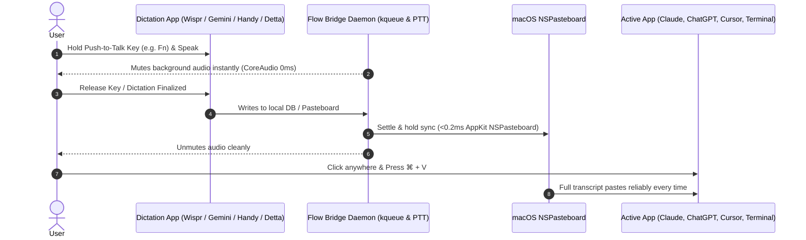

<div align="center">
  
  <h1>Flow Bridge</h1>
  <p><strong>Universal macOS Dictation Clipboard Daemon & Menu Bar Hub</strong><br/>
  <em>Speak into Wispr Flow, Google Gemini, Handy, or Detta — then press <code>⌘ + V</code> anywhere to paste.</em></p>

  <p>
    <a href="https://github.com/sandeepisconscious-create/flow-bridge/releases/download/v1.1.4/FlowBridge-Installer.dmg">
      
    </a>
  </p>

  <p>
    
    
    
    
    
  </p>
</div>

---
## 💡 What is Flow Bridge?

Have you ever used a voice dictation app on your Mac (**Wispr Flow**, **Google Gemini**, **Handy**, or **Detta**) to talk into **Google AI Studio, ChatGPT, Claude, Cursor, VS Code, Slack, or Terminal**, only for your spoken words to **vanish** or fail to paste?

**Flow Bridge solves this permanently at the operating system level.**

Whenever you finish dictating:
1. Flow Bridge catches your spoken words directly from your voice engine or clipboard pipeline in real time.
2. It immediately copies your transcribed text to the macOS clipboard (`NSPasteboard`).
3. You press **`⌘ + V`** (Command + V) anywhere you want, and your text appears every single time.

No browser extensions. No focus-loss bugs. It sits silently in your macOS top menu bar, ready whenever you need it.



---

## ⚡ Problems & Pain Points Flow Bridge Solves

If you arrived here searching for fixes to any of these issues, Flow Bridge is the direct solution:

- ❌ **Wispr Flow / Gemini / Handy not pasting into ChatGPT, Claude, or Google AI Studio**: Complex reactive web editors (ProseMirror, Draft.js, Angular, React virtual DOM) often drop input focus when a dictation floating popup closes, causing synthetic paste events to be swallowed or ignored.
- ❌ **Cursor, VS Code, and Terminal ignoring voice paste**: Desktop Electron apps and terminal windows often reject synthetic accessibility paste events triggered by background apps. Flow Bridge bypasses synthetic typing completely by writing straight to the OS clipboard.
- ❌ **Lost voice text on blur**: If you speak and accidentally click away, your dictation is never lost. Flow Bridge ensures your speech is always waiting on `⌘ + V`.
- ❌ **Overwritten clipboard race conditions**: Dictation apps frequently attempt to restore previous clipboard contents after simulating a paste. Flow Bridge employs an anti-race settle-and-hold loop so your transcribed text cannot be prematurely wiped out.
- ❌ **Multi-app confusion**: If you switch between Wispr Flow, Google Gemini, Handy, and Detta, Flow Bridge monitors all of them concurrently and automatically synchronizes whichever engine you spoke into last.

---

## ✨ Features & Benefits

### 1. Universal `⌘ + V` Dictation Sync
Speak into any supported dictation app. When you're ready, simply click anywhere and press `⌘ + V`. It works reliably in every browser, text editor, terminal, and desktop app.

### 2. Event-Driven macOS Kernel Monitoring (`kqueue` / VNODE)
Flow Bridge doesn't waste battery polling in a tight loop. It binds directly to the macOS kernel using `kqueue(2)` VNODE write notifications on the SQLite databases, directories, and WAL journals. The daemon **sleeps at 0.0% CPU** and wakes up the exact millisecond Wispr Flow, Handy, or Detta commits a new sentence.

### 3. Ultra-Low Latency In-Process AppKit Clipboard (0.1ms)
Transcribed utterances are injected into the macOS `NSPasteboard` directly via in-process Objective-C runtime bindings (`objc_msgSend` via `ctypes`), bypassing slow shell subprocesses and copying in **under 0.2 milliseconds**.

### 4. Native macOS Menu Bar App & Popover HUD
- A sleek blue microphone icon lives in your top macOS menu bar (next to your clock and Wi-Fi).
- Click the icon anytime to drop down an instant popover HUD showing your detected engines and recent transcripts.
- Minimizing or closing the window seamlessly tucks Flow Bridge into the menu bar without cluttering your Dock.

### 5. Clean Dictation Feed & Instant Search
Browse your transcribed utterances organized under a clean **TODAY** feed layout. Tap the search icon to filter across all previous prompts, ideas, or code snippets in real time.

### 6. Zero-Latency Hardware Audio Muting (Push-to-Talk)
While holding down your dictation shortcut (<kbd>Fn</kbd> for Wispr Flow), Flow Bridge instantly silences master speaker output directly at the macOS `CoreAudio` hardware driver level (0 ms latency). It reads your active app's configured push-to-talk key and ignores unrelated modifier combinations, completely eliminating false mutes while typing or using normal keyboard shortcuts.

### 7. Right-Click Menu Bar Controls
Right-click or Control-click the menu bar icon anytime to access a native macOS context menu:
- **Open Dashboard Window**
- **Toggle Sync (Pause / Resume)**
- **Quit Flow Bridge**

### 8. Pause / Resume Sync Toggle
Need to dictate a quick note without overriding your active clipboard? Click the **Active / Paused** toggle button right in the dashboard to pause clipboard sync at any time.

### 9. Seamless Automatic In-Place Updates
Whenever a new release or fix is uploaded to GitHub, Flow Bridge notifies you with an update banner. Click **Install Update** and Flow Bridge will automatically download, install, and refresh in the background.

### 10. Smooth Hover with 1-Click Copy & App Badges
Hovering over any transcript smoothly reveals an engine pill badge (e.g. `Wispr Flow`, `Handy`, `Detta`) and a 1-click **Copy Button (`❐`)** with instant visual checkmark feedback (`✓`). Powered by pure CSS for zero flicker or performance overhead.

### 11. Standalone Desktop Window & Energy Optimization
Double-clicking Flow Bridge opens a clean native macOS desktop window powered by built-in WebKit (`WKWebView`). When closed or hidden, polling completely suspends so your Mac stays cool at 0.0% CPU.

### 12. 100% Private & Offline
Flow Bridge runs entirely on your local machine. It connects only to local SQLite databases on your Mac's filesystem (`127.0.0.1`). No audio, no text, and no telemetry are ever transmitted to any external server.

---

## 🚀 How to Install

Choose whichever method you prefer:

### Method 1: Mac Drag-and-Drop Installer (Recommended)
1. Download **[FlowBridge-Installer.dmg (v1.1.4)](https://github.com/sandeepisconscious-create/flow-bridge/releases/download/v1.1.4/FlowBridge-Installer.dmg)**.
2. Open the downloaded DMG and drag **FlowBridge** into your **Applications** folder.
3. **First-Time Launch (macOS Gatekeeper)**:
   - If macOS displays *"Apple could not verify FlowBridge..."*, click **Done**.
   - Open **System Settings** → **Privacy & Security** → scroll to **Security**.
   - Click **Open Anyway** next to *"FlowBridge was blocked..."*, then confirm **Open**.
   - *(You only need to do this once. Flow Bridge will launch instantly forever after).*
4. A clean native window will open, and the blue microphone icon will appear in your top menu bar.

---

### Method 2: One-Line Terminal Command
Open **Terminal** on your Mac, paste this line, and press Enter:

```bash
curl -fsSL https://raw.githubusercontent.com/sandeepisconscious-create/flow-bridge/main/install.sh | bash
```

> **What this does:** Automatically installs Flow Bridge to `~/.flow-bridge/` and configures a lightweight macOS `launchd` background service so it starts silently whenever your Mac boots.

*To uninstall anytime:*
```bash
curl -fsSL https://raw.githubusercontent.com/sandeepisconscious-create/flow-bridge/main/scripts/uninstall.sh | bash
```

---

## 📋 3-Step Quick Start

1. **Speak** into Wispr Flow, Handy, or Detta.
2. **Click** where you want your text (ChatGPT, Claude, Cursor, Terminal, etc.).
3. **Press `⌘ + V`**. Your speech pastes immediately.

---

## 📁 Supported Voice Dictation Apps

<div align="center">
  <table>
    <tr>
      <td align="center" width="25%">
        <br/>
        <strong>Wispr Flow</strong>
      </td>
      <td align="center" width="25%">
        <br/>
        <strong>Google Gemini</strong>
      </td>
      <td align="center" width="25%">
        <br/>
        <strong>Handy</strong>
      </td>
      <td align="center" width="25%">
        <br/>
        <strong>Detta</strong>
      </td>
    </tr>
  </table>
</div>

| App | Icon | Storage & Integration Pipeline | Status |
|---|:---:|---|---|
| **Wispr Flow** |  | `~/Library/Application Support/Wispr Flow/flow.sqlite` (Kernel `kqueue`) | ✅ Auto-detected |
| **Google Gemini** |  | macOS App (`com.google.gemini`) • Intelligent Dictation Hook | ✅ Auto-detected |
| **Handy** |  | `~/Library/Application Support/com.pais.handy/history.db` (Kernel `kqueue`) | ✅ Auto-detected |
| **Detta** |  | `~/Library/Application Support/Detta/history.db` (Kernel `kqueue`) | ✅ Auto-detected |

*Have another voice dictation tool? Additional engines can be easily plugged in via the extensible `BaseDictationWatcher` interface in `flow_bridge_core/watchers/engines.py`.*

---

## ⚖️ Feature Matrix: Native Apps vs. With Flow Bridge

| Capability | Native Apps Alone | With Flow Bridge |
|:---|:---:|:---:|
| **Paste into Web AI (ChatGPT, Claude, Google AI Studio)** | ❌ Often swallows text / drops focus | ✅ **Guaranteed `⌘ + V` paste** |
| **Desktop Dev Tools (Cursor, VS Code, Ghostty, iTerm2)** | ⚠️ Unreliable synthetic typing | ✅ **Instant native clipboard paste** |
| **Master Speaker Muting during Dictation** | ⚠️ App-specific only | ✅ **Universal 0ms hardware mute** |
| **Searchable Today History Feed** | ❌ None | ✅ **Live searchable transcript log** |
| **1-Click Re-Copy Previous Dictations** | ❌ None | ✅ **Instant 1-click clipboard button** |
| **CPU Footprint on Idle** | ~150MB+ | 🟢 **0.0% CPU (macOS kernel `kqueue`)** |

---

## 🛠️ CLI Developer Options & Advanced Flags

If you prefer running Flow Bridge directly from the terminal or embedding it in your own automation scripts, `flow_bridge.py` supports several power-user flags:

```bash
# Run with custom polling interval & verbose debugging
python3 flow_bridge.py --poll 0.2 --verbose

# Run with native desktop notifications on every sync
python3 flow_bridge.py --notify

# Adjust settle-and-hold timing for slow web apps
python3 flow_bridge.py --settle 0.4 --reassert 4

# Test AppKit clipboard injection and exit
python3 flow_bridge.py --test-clipboard

# Open the HUD dashboard directly in your default browser
python3 flow_bridge.py --dashboard
```

| Flag | Default | Description |
|---|:---:|---|
| `--poll <float>` | `0.25` | Fallback polling interval in seconds when kernel kqueue is idle |
| `--settle <float>` | `0.35` | Anti-race settlement delay before reasserting clipboard contents |
| `--reassert <int>` | `3` | Number of times to reassert the transcript to defeat hostile paste-cleaners |
| `--notify` | `False` | Display a native macOS notification banner whenever a dictation syncs |
| `--verbose` | `False` | Print timestamped debug logs for every event and key state query |
| `--install-service` | — | Automatically generates and loads the user `launchd` login agent |
| `--uninstall-service`| — | Unloads and removes the background `launchd` login agent |

---

## ❓ Frequently Asked Questions (FAQ)

#### Does Flow Bridge take up space in my Dock?
No. Flow Bridge runs as a background accessory app (`LSUIElement`). It stays in your top menu bar and does not clutter your Dock.

#### Does it send my voice or text anywhere?
**No. Never.** Flow Bridge runs 100% locally on your computer. Nothing ever leaves your Mac.

#### Can I re-copy something I dictated 10 minutes ago?
Yes. Click the blue microphone icon in your top menu bar or open the window. Your 10 most recent dictations are listed there with 1-click copy buttons.

#### Why does normal auto-paste fail in web AI apps?
Complex websites often drop cursor focus or ignore simulated accessibility keystrokes while voice popups blur and close. Flow Bridge bypasses web synthetic event trees completely by ensuring your transcribed words are already on the native macOS clipboard.

---

## 📄 License & Credits

Created with ❤️ by [Sandheep Rao](https://github.com/sandeepisconscious-create).

Licensed under the [MIT License](LICENSE).
