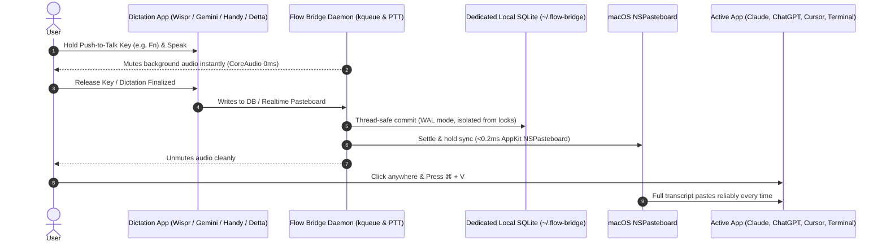

<div align="center">
  
  <h1>Flow Bridge</h1>
  <p><strong>Universal macOS Dictation Clipboard Daemon & Desktop History Hub</strong><br/>
  <em>Speak into Wispr Flow, Google Gemini, Handy, or Detta — then press <code>⌘ + V</code> anywhere to paste.</em></p>

  <p>
    <a href="https://github.com/sandeepisconscious-create/flow-bridge/releases/download/v1.1.6/FlowBridge-Installer.dmg">
      
    </a>
  </p>

  <p>
    
    
    
    
    
    
  </p>
</div>

---
## 💡 What is Flow Bridge?

Have you ever used a voice dictation app on your Mac (**Wispr Flow**, **Google Gemini**, **Handy**, or **Detta**) to talk into **Google AI Studio, ChatGPT, Claude, Cursor, VS Code, Slack, or Terminal**, only for your spoken words to **vanish** or fail to paste?

**Flow Bridge solves this permanently at the operating system level.**

Whenever you finish dictating:
1. Flow Bridge captures your spoken words directly from your voice engine or clipboard pipeline in real time.
2. It commits the transcript into an **isolated, dedicated local database** (`~/.flow-bridge/dictations.sqlite`).
3. It immediately synchronizes your transcribed text to the macOS clipboard (`NSPasteboard`).
4. You press **`⌘ + V`** (Command + V) anywhere you want, and your text appears every single time.

It sits quietly in your macOS top menu bar, ready whenever you need it, and opens into a full-featured desktop history and management studio whenever you want to search or manage your transcripts.



---

## ⚡ Problems & Pain Points Flow Bridge Solves

- ❌ **Wispr Flow / Gemini / Handy not pasting into ChatGPT, Claude, or Google AI Studio**: Complex reactive web editors (ProseMirror, Draft.js, Angular, React virtual DOM) often drop input focus when a dictation floating popup closes, causing synthetic paste events to be swallowed or ignored.
- ❌ **Cursor, VS Code, and Terminal ignoring voice paste**: Desktop Electron apps and terminal windows often reject synthetic accessibility paste events triggered by background apps. Flow Bridge bypasses synthetic typing completely by writing straight to the OS clipboard.
- ❌ **Lost voice text on blur**: If you speak and accidentally click away, your dictation is never lost. Flow Bridge preserves everything in local storage and ensures your speech is waiting on `⌘ + V`.
- ❌ **Overwritten clipboard race conditions**: Dictation apps frequently attempt to restore previous clipboard contents after simulating a paste. Flow Bridge employs an anti-race settle-and-hold loop so your transcribed text cannot be prematurely wiped out.
- ❌ **Database lock collisions & crashes**: Reading directly from Wispr Flow's active 750MB+ database during live checkpointing can cause pointer corruption or SQLite locks. Flow Bridge isolates all UI operations and queries in its own dedicated, thread-safe SQLite database.
- ❌ **Multi-app confusion**: If you switch between Wispr Flow, Google Gemini, Handy, and Detta, Flow Bridge monitors all of them concurrently and automatically synchronizes whichever engine you spoke into last.

---

## ✨ Features & Capabilities

### 1. Dedicated Local SQLite Storage (`~/.flow-bridge/dictations.sqlite`)
- Completely decoupled from third-party app databases to eliminate SQLite WAL checkpoint collisions and segmentation faults.
- Employs **WAL (Write-Ahead Logging)** mode, indexed timestamp queries, and thread-safe mutex locking (`threading.RLock`).
- Preserves full transcript history across all sessions, reboots, and app updates.

### 2. Full Google Gemini macOS App Integration
- Native real-time capture of Gemini's **"Stream to Cursor"** (`STC`) voice transcripts.
- High-efficiency pasteboard `changeCount` monitoring combined with frontmost app resolution (`com.google.GeminiMacOS`), ensuring 100% capture accuracy with zero CPU overhead.

### 3. Dual-Mode User Interface
- **Menu Bar Popover (`540px`)**:
  - Compact, translucent quick-access HUD.
  - Quick toggles for Universal Sync and Auto-Mute on Dictation.
  - Recent dictation feed with 1-click copy buttons.
  - Clean **"Open App"** button in the header.
- **Full Desktop App Window**:
  - macOS-style sidebar navigation.
  - **Tab 1: Essentials**: Real-time engine health cards (Wispr Flow, Gemini, Detta, Handy), routing controls, and live productivity analytics (total transcripts recorded, words spoken, estimated typing time saved).
  - **Tab 2: History**: Dedicated full-screen dictation manager with keyword search, source filtering, and history management.

### 4. Customizable History Deletion with Tombstone Protection
- **Single-Item Deletion**: Hover over any transcript in the desktop window and click the trash icon for immediate removal with real-time metric updates.
- **Customizable Time-Range Batch Deletion ("Clear History...")**:
  - Delete by time range: **Past 24 Hours**, **Past 2 Days (48 Hours)**, **Past 7 Days**, **Older than 2 Days**, **Older than 7 Days**, **Older than 30 Days**, or **All Time**.
  - Scope to all engines or a single engine (e.g. *"Delete only Gemini dictations from the past 2 days"*).
- **Permanent Tombstone Safeguard**: Deleted records are tracked in a `deleted_dictations` table so third-party external watchers never re-import dictations you explicitly deleted.

### 5. Event-Driven macOS Kernel Monitoring (`kqueue` / VNODE)
Flow Bridge doesn't waste battery polling in a tight loop. It binds directly to the macOS kernel using `kqueue(2)` VNODE write notifications on external SQLite databases and WAL journals. The daemon **sleeps at 0.0% CPU** and wakes up the exact millisecond a new sentence is committed.

### 6. Ultra-Low Latency In-Process AppKit Clipboard (0.1ms)
Transcribed utterances are injected into the macOS `NSPasteboard` directly via in-process Objective-C runtime bindings (`objc_msgSend` via `ctypes`), bypassing slow shell subprocesses and copying in **under 0.2 milliseconds**.

### 7. Zero-Latency Hardware Audio Muting (Push-to-Talk)
While holding down your dictation shortcut (<kbd>Fn</kbd> for Wispr Flow), Flow Bridge instantly silences master speaker output directly at the macOS `CoreAudio` hardware driver level (0 ms latency), eliminating acoustic feedback and preventing false mutes during normal typing.

### 8. Crash-Proof Startup & Seamless Navigation
Flow Bridge incorporates background polling and resilient WebKit navigation delegates to ensure the UI immediately reconnects whenever you quit and reopen the application.

---

## 🚀 Installation & Setup

### Method 1: Mac Drag-and-Drop Installer (Recommended)
1. Download **[FlowBridge-Installer.dmg (v1.1.6)](https://github.com/sandeepisconscious-create/flow-bridge/releases/download/v1.1.6/FlowBridge-Installer.dmg)**.
2. Open the downloaded DMG and drag **FlowBridge** into your **Applications** folder.
3. **First-Time Launch (macOS Gatekeeper)**:
   - If macOS displays *"Apple could not verify FlowBridge..."*, click **Done**.
   - Open **System Settings** → **Privacy & Security** → scroll to **Security**.
   - Click **Open Anyway** next to *"FlowBridge was blocked..."*, then confirm **Open**.
   - *(You only need to do this once. Flow Bridge will launch instantly forever after).*
4. The blue microphone icon will appear in your menu bar.

---

### Method 2: One-Line Terminal Command
Open **Terminal** on your Mac, paste this line, and press Enter:

```bash
curl -fsSL https://raw.githubusercontent.com/sandeepisconscious-create/flow-bridge/main/install.sh | bash
```

> **What this does:** Automatically installs Flow Bridge to `~/.flow-bridge/` and configures a lightweight macOS `launchd` background service so it starts silently whenever your Mac boots.

*To uninstall anytime:*
```bash
curl -fsSL https://raw.githubusercontent.com/sandeepisconscious-create/flow-bridge/main/scripts/uninstall.sh | bash
```

---

## 📋 3-Step Quick Start

1. **Speak** into Wispr Flow, Google Gemini, Handy, or Detta.
2. **Click** where you want your text (ChatGPT, Claude, Cursor, Terminal, etc.).
3. **Press `⌘ + V`**. Your speech pastes immediately.

---

## 📁 Supported Voice Dictation Engines

<div align="center">
  <table>
    <tr>
      <td align="center" width="25%">
        <br/>
        <strong>Wispr Flow</strong>
      </td>
      <td align="center" width="25%">
        <br/>
        <strong>Google Gemini</strong>
      </td>
      <td align="center" width="25%">
        <br/>
        <strong>Handy</strong>
      </td>
      <td align="center" width="25%">
        <br/>
        <strong>Detta</strong>
      </td>
    </tr>
  </table>
</div>

| Engine | Integration Pipeline | Status |
|---|---|:---:|
| **Wispr Flow** | `~/Library/Application Support/Wispr Flow/flow.sqlite` (Kernel `kqueue` VNODE) | ✅ Auto-detected |
| **Google Gemini** | macOS Native App (`com.google.GeminiMacOS`) • Stream to Cursor Hook | ✅ Auto-detected |
| **Handy** | `~/Library/Application Support/com.pais.handy/history.db` (Kernel `kqueue`) | ✅ Auto-detected |
| **Detta** | `~/Library/Application Support/Detta/history.db` (Kernel `kqueue`) | ✅ Auto-detected |

---

## ⚖️ Feature Matrix: Native Dictation Apps vs. With Flow Bridge

| Capability | Native Apps Alone | With Flow Bridge |
|:---|:---:|:---:|
| **Paste into Web AI (ChatGPT, Claude, Google AI Studio)** | ❌ Often swallows text / drops focus | ✅ **Guaranteed `⌘ + V` paste** |
| **Desktop Dev Tools (Cursor, VS Code, Ghostty, iTerm2)** | ⚠️ Unreliable synthetic typing | ✅ **Instant native clipboard paste** |
| **Dedicated Local SQLite Storage** | ❌ Scattered / app-dependent | ✅ **Unified database (`~/.flow-bridge/`)** |
| **Master Speaker Muting during Dictation** | ⚠️ App-specific only | ✅ **Universal 0ms hardware mute** |
| **Searchable History Feed & Analytics** | ❌ None | ✅ **Desktop window with search & stats** |
| **Customizable History Deletion (e.g. 2 days)** | ❌ None | ✅ **Built-in range & item deletion** |
| **CPU Footprint on Idle** | ~150MB+ | 🟢 **0.0% CPU (kernel `kqueue`)** |

---

## 🛠️ CLI Developer Options & Advanced Flags

If you prefer running Flow Bridge directly from the terminal or embedding it in your own automation scripts, `flow_bridge.py` supports several power-user flags:

```bash
# Run with custom polling interval & verbose debugging
python3 flow_bridge.py --poll 0.2 --verbose

# Run with native desktop notifications on every sync
python3 flow_bridge.py --notify

# Adjust settle-and-hold timing for slow web apps
python3 flow_bridge.py --settle 0.4 --reassert 4

# Test AppKit clipboard injection and exit
python3 flow_bridge.py --test-clipboard

# Open the HUD dashboard directly in your default browser
python3 flow_bridge.py --dashboard
```

| Flag | Default | Description |
|---|:---:|---|
| `--poll <float>` | `0.25` | Fallback polling interval in seconds when kernel kqueue is idle |
| `--settle <float>` | `0.35` | Anti-race settlement delay before reasserting clipboard contents |
| `--reassert <int>` | `3` | Number of times to reassert the transcript to defeat hostile paste-cleaners |
| `--notify` | `False` | Display a native macOS notification banner whenever a dictation syncs |
| `--verbose` | `False` | Print timestamped debug logs for every event and key state query |
| `--install-service` | — | Automatically generates and loads the user `launchd` login agent |
| `--uninstall-service`| — | Unloads and removes the background `launchd` login agent |

---

## ❓ Frequently Asked Questions (FAQ)

#### Does Flow Bridge take up space in my Dock?
No. Flow Bridge runs as a background accessory app (`LSUIElement`). It stays in your top menu bar and only opens the full window when you request it.

#### Does it send my voice or text anywhere?
**No. Never.** Flow Bridge runs 100% locally on your computer. Nothing ever leaves your Mac. All transcripts are stored strictly on your local disk at `~/.flow-bridge/dictations.sqlite`.

#### Can I delete my dictation history?
Yes! In the full desktop window's **History** tab, you can delete individual dictations via the trash icon, or click **"Clear History..."** to delete by customizable ranges (e.g., past 2 days, past 7 days, older than 2 days, or all time).

#### How do I cleanly uninstall Flow Bridge?
You can uninstall Flow Bridge completely at any time by either:
1. Moving **FlowBridge.app** from `/Applications` to the **Trash**, or
2. Running the clean uninstaller script in Terminal:
```bash
curl -fsSL https://raw.githubusercontent.com/sandeepisconscious-create/flow-bridge/main/scripts/uninstall.sh | bash
```
This cleanly stops all background processes, unloads the LaunchAgent, and removes application data.

---

## 📄 License & Credits

Created with ❤️ by [Sandheep Rao](https://github.com/sandeepisconscious-create).

Licensed under the [MIT License](LICENSE).
